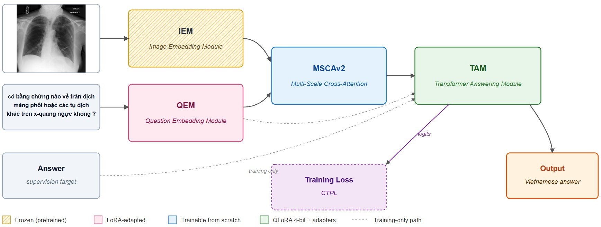
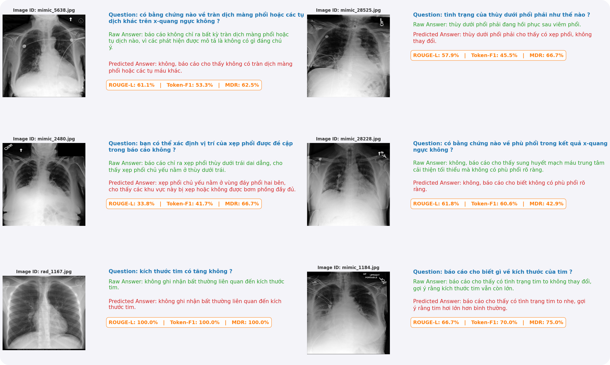

# Vietnamese Medical VQA Project

Showcase website for the **Advancing Vietnamese Visual Question Answering (VQA) for Healthcare** project.

🌐 Project page: [verisbaby.github.io/duancntt](https://verisbaby.github.io/duancntt)

---

## Overview

Medical Visual Question Answering (VQA) in Vietnamese is constrained by scarce datasets and by encoders that struggle with Vietnamese linguistic traits such as unmarked word boundaries and concatenated medical compounds (for example `trànndịchmàngphổi` instead of `tràn dịch màng phổi`).

This project builds a **parameter-efficient multimodal VQA system for Vietnamese chest X-ray interpretation**. Given a chest X-ray and a free-form Vietnamese question, the system generates a free-form Vietnamese clinical answer.

**Key ideas**

- **Dual vision backbone**: frozen BiomedCLIP (biomedical semantics) + frozen DINOv3 (fine-grained anatomy).
- **Vietnamese clinical question encoder**: ViHealthBERT adapted with LoRA.
- **MSCAv2 (Multi-Scale Cross-Attention)**: a small custom bridge, trained from scratch, that fuses image and question into a compact visual prompt.
- **TAM (Transformer Answering Module)**: Qwen2.5-3B-Instruct in 4-bit with QLoRA adapters generates the Vietnamese answer.
- **Clinical-Token Priority Loss (CTPL)**: a weighted cross-entropy that gives extra gradient mass to clinically salient tokens.
- **Vietnamese-aware text pipeline**: Unicode NFC normalisation, abbreviation expansion, a corpus-derived dynamic-programming syllable re-segmenter, and word segmentation for ViHealthBERT.
- **Runs on a single NVIDIA T4 (16 GB)**: total trainable parameters are below 1% of the full model.

---

## Model Architecture

*Figure: Overall architecture. The image is encoded by a frozen Image Embedding Module (IEM: BiomedCLIP + DINOv3); the Vietnamese question is encoded by a LoRA-adapted Question Embedding Module (QEM: ViHealthBERT). MSCAv2 fuses both modalities into a compact visual token set that, together with the question, conditions the QLoRA-adapted Transformer Answering Module (TAM: Qwen2.5-3B-Instruct). Dashed paths are active only during training.*

| Module | Backbone | Training mode | Output shape |
|---|---|---|---|
| **IEM** (Image Embedding) | BiomedCLIP ViT-B/16 + DINOv3 ViT-S/16, plus a trainable `dim_proj` (384 to 768) | Frozen encoders | `enhanced_global` (5 × 768), `enhanced_local` (196 × 768) |
| **QEM** (Question Embedding) | ViHealthBERT-base-word | LoRA (r = 8, α = 16) on query/key/value | (128 × 768) |
| **MSCAv2** (Multi-Scale Cross-Attention) | Custom, no pretrained weights | Trained from scratch (~3.7M parameters) | `visual_summary` (32 × 256) |
| **TAM** (Transformer Answering) | Qwen2.5-3B-Instruct, 4-bit NF4 | QLoRA (r = 8, α = 16) on all attention and MLP projections | Vietnamese answer tokens |

**MSCAv2 in brief**: question tokens query the global stream (Scale A, 5 tokens) and the local stream (Scale B, 196 patch tokens) through a shared 3-layer, 8-head cross-attention block (dimension 256). A learnable scale gate combines the two streams, and a 1-D convolution (kernel 4, stride 4) pools the 128 question-conditioned tokens down to 32 visual prompt tokens.

**TAM input layout (training)**: `[visual prefix (32) | projected question (128) | answer (128)] = 288 tokens`. At inference the answer slot is empty and TAM generates the answer autoregressively.

**CTPL**: for each target token `y`, the weight is `w(y) = 1 + (w_clinical − 1) · m_y`, where `m_y = 1` if the token belongs to the top-1,500 clinical vocabulary (words of length ≥ 5 from training answers). `w_clinical = 1.8` (clamped to [1.0, 2.0]), with label smoothing ε = 0.05.

---

## Results

All results are on the held-out **800-sample test set**. Metrics: ROUGE-L, BLEU-4, Medical Diagnostic Recall (MDR, a clinical-keyword recall metric introduced in this project) and token-level accuracy.

### Comparison with public vision-language models

| Model | ROUGE-L | BLEU-4 | MDR | Token Accuracy |
|---|---|---|---|---|
| **Our model** | **53.56%** | **24.65%** | **64.58%** | **45.60%** |
| Qwen2.5-VL-3B | 41.34% | 12.68% | 52.88% | 35.07% |
| InternVL3-2B | 41.56% | 12.57% | 48.40% | 31.51% |
| Gemma-3-4B | 38.12% | 9.78% | 46.62% | 29.96% |

*Baselines are evaluated zero-shot with identical Vietnamese prompts and greedy decoding. Our model uses the 12-epoch continuation checkpoint, also with greedy decoding.*

**Beam search.** With beam-4 decoding, the same checkpoint reaches **55.41% ROUGE-L, 27.15% BLEU-4 and 64.45% MDR**.

### Ablation study (validation set, 800 samples, 6 epochs)

| ID | Vision encoder | Text aug + segmentation | LoRA on QEM/TAM | Token-F1 | ROUGE-L | BLEU-4 | MDR |
|---|---|---|---|---|---|---|---|
| E0 | BiomedCLIP only | No | No | 48.09% | 51.99% | 24.11 | 63.25% |
| E1 | BiomedCLIP + DINOv3 | No | No | 45.00% | 49.69% | 22.06 | 60.51% |
| E2 | BiomedCLIP only | No | Yes | 48.78% | 52.54% | 24.26 | **63.36%** |
| **E3** | **BiomedCLIP + DINOv3** | **Yes** | **Yes** | **49.18%** | **53.06%** | **24.90** | 62.73% |

**Takeaways**

- Adding DINOv3 *without* the Vietnamese text pipeline lowers ROUGE-L by 2.30 points (E1 vs E0): extra visual capacity does not help when textual features are degraded.
- LoRA alone gives a modest, consistent gain (E2 vs E0).
- The full system (E3) is best on Token-F1, ROUGE-L and BLEU-4, and competitive on MDR.

---

## Demo

*Example predictions on held-out test images. For each sample: the Vietnamese question (blue), the reference answer (green), the model prediction (red), and the per-sample ROUGE-L, Token-F1 and MDR scores.*

---

## Data Pipeline

1. **Dataset selection**: MIMIC-CXR (chest radiographs with free-text reports) and the chest subset of VQA-RAD (radiologist-verified Q&A).
2. **Clinically constrained translation**: GPT-4o under a strict system prompt (clinical persona, no adding or removing findings, preserved negations, an embedded English-to-Vietnamese terminology dictionary, formatting rules).
3. **Vietnamese medical text processing**: syllable lexicon, Unicode NFC, abbreviation expansion, DP syllable re-segmenter, Underthesea word segmentation.
4. **Train-time question augmentation**: synonym replacement, word dropout (negators `không` / `chưa` protected), template swap, applied with probability 0.6 to questions only.
5. **Stratified split** and a custom PyTorch `Dataset` / `DataLoader`.

---

## Limitations

- **Translation provenance**: the corpus is machine-translated from English; native Vietnamese radiologists did not spot-validate it.
- **Zero-shot baselines**: baselines were not fine-tuned on the Vietnamese corpus.
- **Single split**: results come from one 80/10/10 split (seed 42); k-fold cross-validation would be more robust.
- **Modality scope**: chest X-ray only.
- **Acquisition shift**: images come from US hospitals; performance on radiographs acquired in Vietnamese hospitals has not been measured.

This is a research prototype for clinical decision support, not a medical device.

---

## Team

| Member | Student ID | Main responsibilities |
|---|---|---|
| Trần Thị Thế Nhân | Vietnamese medical data processing pipeline; IEM, QEM, MSCA, TAM and CTPL implementation; training and ablation experiments; architecture diagrams; primary report author |
| Nguyễn Phúc Minh Đăng | Translation pipeline; first-pass Vietnamese text cleaning (Unicode normalisation) |

**Advisor:** Assoc. Prof. Dr. Lê Anh Cường, Faculty of Information Technology, Ton Duc Thang University.

---

## Key References

- BiomedCLIP: Zhang et al. (2024). [arXiv:2303.00915](https://arxiv.org/abs/2303.00915)
- DINOv3: Siméoni et al. (2025). [arXiv:2508.10104](https://arxiv.org/abs/2508.10104)
- ViHealthBERT: Nguyen et al. (2022). [arXiv:2203.02320](https://arxiv.org/abs/2203.02320)
- Qwen2.5-VL Technical Report: Bai et al. (2025). [arXiv:2502.13923](https://arxiv.org/abs/2502.13923)
- LoRA: Hu et al. (2022). [arXiv:2106.09685](https://arxiv.org/abs/2106.09685)
- QLoRA: Dettmers et al. (2023). [arXiv:2305.14314](https://arxiv.org/abs/2305.14314)
- Flamingo: Alayrac et al. (2022). [arXiv:2204.14198](https://arxiv.org/abs/2204.14198)
- VQA-RAD: Lau et al. (2018). [Scientific Data](https://doi.org/10.1038/sdata.2018.251)
- MIMIC-CXR: Johnson et al. (2019). [Scientific Data](https://doi.org/10.1038/s41597-019-0322-0)
- InternVL: Chen et al. (2024). [arXiv:2312.14238](https://arxiv.org/abs/2312.14238)
- Gemma 3: Team Gemma (2025). [Google DeepMind](https://deepmind.google/technologies/gemma/)
